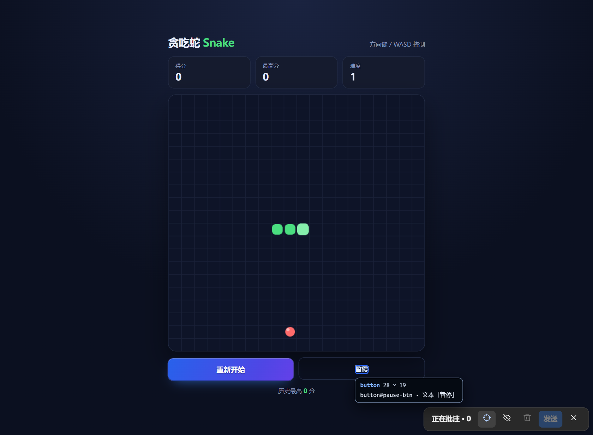
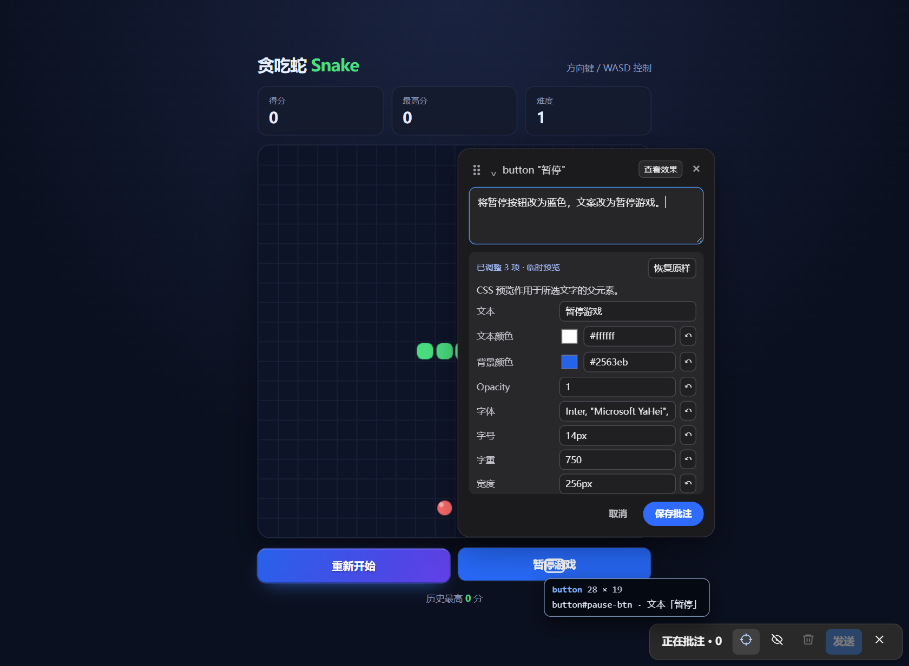
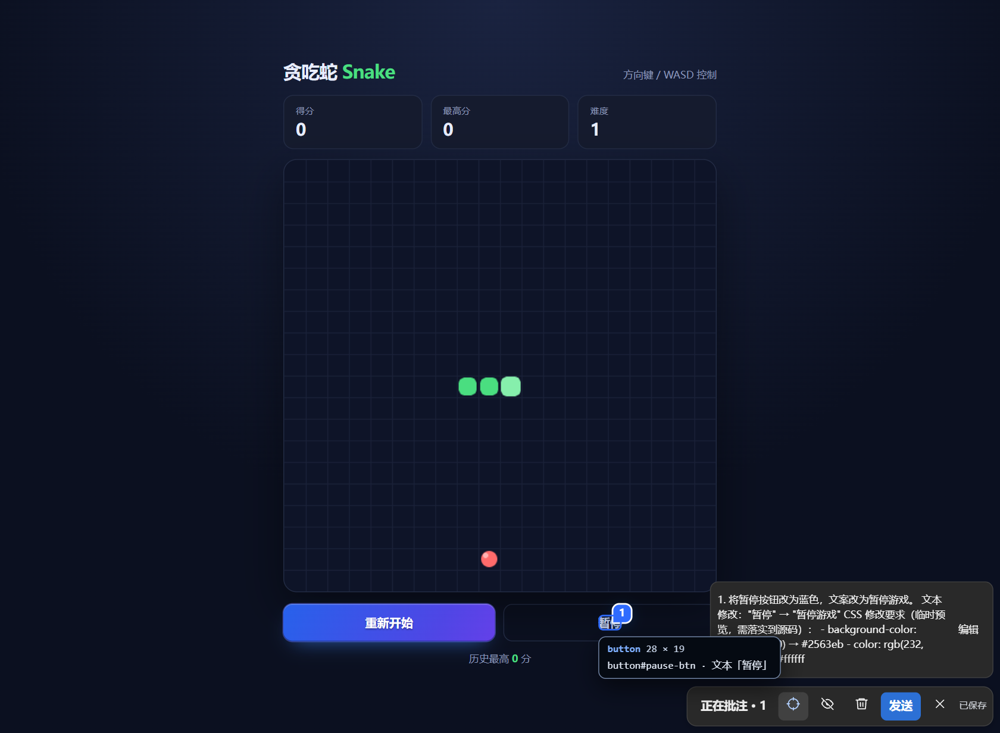
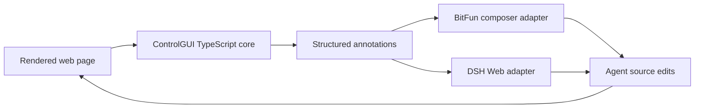

# ControlGUI

Visual feedback and live editing for agent-generated web interfaces.

ControlGUI lets users pick rendered DOM elements, preview CSS and text changes, and send structured annotations to a coding agent for durable source edits. One TypeScript core is shared by BitFun and a compatible DSH Web host.

## Features

- DOM and text-node selection, hover outlines, numbered annotations.
- Live CSS editing (34 common properties, advanced property search, color picker), text preview and reset.
- Adaptive, draggable editor with a compact preview mode.
- Structured annotations including element paths, requested changes and CSS/text differences.
- BitFun chat-composer attachments; DSH direct annotation delivery.

## Live demo

Real Chromium screenshots from the DSH Web preview sidecar, using the bundled Snake test page (no private workspace or chat data).

| Select an element | Live CSS and text preview | Save a structured annotation |
| --- | --- | --- |
|  |  |  |

The browser test verified element picking, live CSS and text changes, restoration after saving, numbered annotations, structured submission payloads, and retention on simulated host refusal. The final Agent acceptance and source edit were not exercised in this test. Canvas-drawn objects (such as the Snake game's red food) are not individual DOM nodes and cannot be edited individually with the current picker.

## Quick start

### BitFun

Requires a compatible browser-extension host. Stock OpenBitFun does **not** ship this custom loader. For a clean checkout of the supported upstream commit, follow [the adapter guide](adapters/bitfun/README.md), then import `assets/shared-controlgui.bitfun-plugin.json` through Browser → Plugins → Install local plugin. If you already have the compatible v1 loader, importing the JSON is enough.

### DSH Web

Requires a separately obtained compatible DSH environment and its existing Web profile. From the ControlGUI repository root:

```sh
node install.mjs --home /path/to/.dsh --profile web
```

Restart DSH Web. To update the shared runtime, run `node install-shared-package.mjs assets/shared-controlgui.bitfun-plugin.json` and refresh the preview. To disable the adapter, run the install command with `--uninstall`. The installer backs up the profile before changing it.

## Architecture



## Develop

Node.js 24+ and pnpm are required for the independent core:

```sh
cd core
pnpm install --frozen-lockfile --ignore-scripts
pnpm build
pnpm test
pnpm test:dom
```

The core build produces `core/dist/controlgui-0.1.1.bitfun-plugin.json` (relative to the repository root). The checked-in shared package supports hosts implementing the v1 ABI. See [core documentation](core/README.md) for build details.

## Repository layout

| Path | Purpose |
| --- | --- |
| `core/` | Shared picker, editor, marker and annotation protocol; unit and DOM tests |
| `adapters/bitfun/` | OpenBitFun host integration patch and installation guide |
| `src/`, `lib/` | DSH Web adapter source and required browser bundle |
| `assets/` | Shared JSON and generated DSH page runtime |
| `tests/` | DSH regression tests and sample fixtures |

## Boundaries

Preview changes are temporary. Saving annotations requests Agent edits; it does not write application source files. Only direct text nodes and supported standard CSS values can be edited. CSS variables, pseudo-elements, resource-loading values and complex HTML/form-value edits are excluded. Import only trusted local plugin packages; this is not a sandbox for untrusted scripts. Host-specific integrations require compatible host versions. Full native desktop and real Agent source-edit end-to-end acceptance are still open.

## License

MIT. See [LICENSE](LICENSE) and [NOTICE.md](NOTICE.md).

独立的可视化批注与 CSS/文本实时编辑插件，支持 BitFun 与兼容 DSH Web。核心源码、构建、测试均不依赖宿主。
